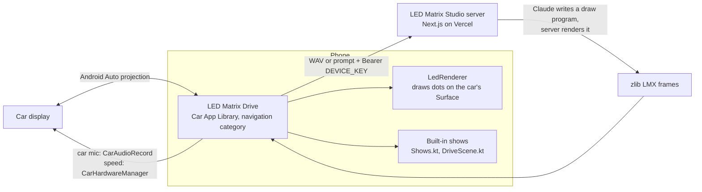

# LED Matrix Drive

An Android Auto app that turns the car's screen into a giant LED matrix. Say an idea ("a dragon
breathing fire") and an AI draws it as a pixel animation, or pick one of the built-in scenes,
including a Rocket, Speedboat and Plane that move with the car's real speed.

It started as a weekend project for the kids, after going from a Tesla to an Audi Q4 e-tron and
missing the fun on the big screen. It's a personal project for inspiration, not a store app.

## What it does

- **Mic**: say an idea; the server turns speech into a prompt and the AI into frames.
- **LEDs**: the animations it made, full screen, with round glowing LEDs or crisp square pixels.
- **Car view**: a pixel Q4 driving down a road that scrolls with the car's speed, read from the car itself.
- **Speed scenes**: Rocket, Speedboat and Plane, which go faster as you do.
- **Tiles**: about 25 shows drawn by the app itself with no server: clock, fireworks, aquarium,
  fireplace, snowy cabin, aurora, a fart button with real sounds, and two games that only open when parked.
- **Tronbyt**: a dozen clips rendered from the open-source [Tronbyt apps](https://github.com/tronbyt/apps).
- **Surprise**: a random idea. **Settings**: sound, one color or full color, glow, square pixels, 128×64.

The phone shows the same animation, and its **Test** button plays a pretend drive (0 to 100 mph
and back) so you can try the speed scenes on the couch.

## How it works



- Android Auto only lets **navigation** apps (and games) draw freely on the screen; every other kind
  gets fixed templates. So this is a Car App Library navigation app with a `NavigationTemplate`
  whose map surface is the LED panel (`LedScreen.kt`, `LedRenderer.kt`).
- The AI part lives on the server, [led-matrix-ai](https://github.com/smartcreations/led-matrix-ai),
  the same one the physical ESP32 panel uses (`/api/device/animation`, `/api/device/voice`).
- Speed comes from `CarHardwareManager` (`CarSpeed.kt`), which needs the car-speed permission.
- Drawing runs on its own thread at up to 30 fps and skips frames that didn't change, to keep the phone cool.

## Build

Needs the Android SDK and JDK 17+ (Android Studio's bundled JDK works).

1. Run your own copy of the server (see led-matrix-ai) and set a `DEVICE_KEY` there.
2. Copy the two `ledmatrix.` lines from `local.properties.example` into `local.properties` and
   fill in your server address and device key. Git ignores `local.properties`.
3. Plug in the phone with USB debugging on and run `./gradlew installDebug`.

## Test without a car

1. In Android Studio's SDK Manager → SDK Tools, install **Android Auto Desktop Head Unit Emulator**.
2. On the phone: Android Auto settings → tap **Version** about 10 times → ⋮ → **Developer settings**
   → **Start head unit server**.
3. On the computer:

   ```bash
   adb forward tcp:5277 tcp:5277
   ~/Library/Android/sdk/extras/google/auto/desktop-head-unit
   ```

The app keeps a log of drives and crashes; share it from the phone app's **Log** button, or
`adb exec-out run-as com.smartcreations.ledmatrixauto cat files/led-log.txt`.

## Getting it into a real car

This is the surprising part. A sideloaded Car App Library app shows up on the desktop head unit,
but a real car (and Android Auto's launcher settings) rejects it:

```
CAR.VALIDATOR: Package DENIED; failed all other checks [your.package]
```

Android Auto's **Unknown sources** setting doesn't cover template apps, and faking the installer
with `adb install -i com.android.vending` doesn't help either. What works is installing from Google
Play through a private **internal testing** track (no review, up to 100 testers you choose):

1. `./gradlew bundleRelease` with your own upload key (see `keystore.properties` in `app/build.gradle.kts`).
2. Play Console → Create app → Testing → Internal testing → add yourself as a tester → upload the `.aab`.
3. Open the opt-in link on the phone and install from Play.

A navigation app that doesn't navigate won't pass review for the public store, so keep it on the
internal track.

## Build your own with Claude

Paste this into Claude Code (or any coding agent) in an empty folder to get the skeleton:

```text
Build an Android Auto app in Kotlin with the Car App Library (androidx.car.app 1.7, plus
app-projected) that uses the whole car screen as an LED dot-matrix display.

- Declare it as a NAVIGATION category CarAppService, with automotive_app_desc "template",
  the NAVIGATION_TEMPLATES and ACCESS_SURFACE permissions, and ALLOW_ALL_HOSTS_VALIDATOR
  for a personal build.
- The screen is a NavigationTemplate with an ActionStrip; register a SurfaceCallback and draw
  on the Surface with lockCanvas (software canvas) on a background thread at up to 30 fps.
- Render a 64x32 grid of round, glowing LEDs that fills the surface, and play animations as
  lists of frames (RGB pixels). Start with three built-in animations drawn in code.
- Read the car's speed with CarHardwareManager (CarInfo.addSpeedListener, CAR_SPEED
  permission) and show a scene that moves faster with the speed.
- A phone activity that shows the same animation and has a "Test drive" button that fakes speed.
- Optional: record with CarAudioRecord and POST the WAV to a server that returns frames.
Explain how to test with the Desktop Head Unit, and keep any server URL or key in
local.properties, never in code.
```

## Credits and license

The code is MIT licensed, see [LICENSE](LICENSE). The fart recordings (Wikimedia Commons, CC0,
public domain, CC BY-SA) and the Tronbyt clips (Apache 2.0) keep their own licenses; see
[CREDITS.md](CREDITS.md). Audi and Q4 e-tron are trademarks of AUDI AG; this project isn't
affiliated with Audi. Built with Claude Code.
